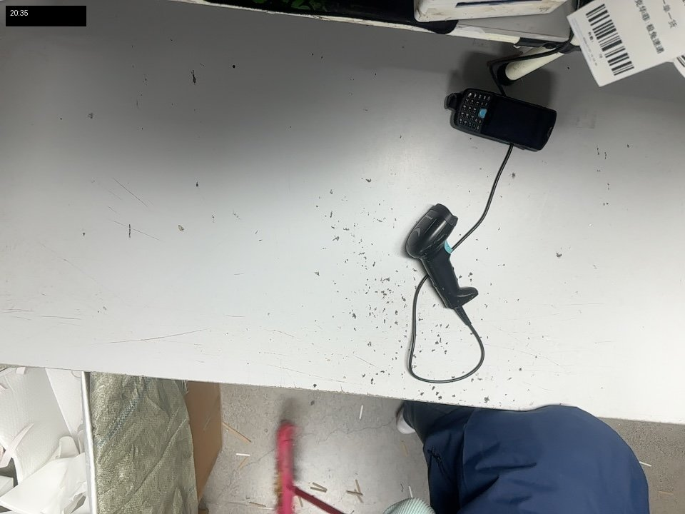

# 人手检测后的空档

看不到手超过 5 秒，标 `idle_no_person`。手还在、但帧差低于 0.02 超过 5 秒，标 `present_but_unrelated`。原片不删。SigLIP 的 0.02 没有改。

上一版把确认时间写成 15 秒，两端再各削 5 秒。那是规格里的 `person_absence_confirm_seconds`。按现在的标准，超过 5 秒就算无效，不再削掉。

- `episode_20261121T111754Z_068864d3-4a08-4f8e-8719-55ea200d8b7e`
- 每 5 秒一帧。MediaPipe Hands，置信度 0.5

## 人工指出的两段

13:55 手还在桌面上。14:00 起没检出手，标到 14:25。14:20 两只手已经放在气泡袋上，检测器没有框，所以这段把人回来的那一拍也算了进去。

14:45–15:15 落在 14:40–16:00 里。16:00 手回到画面。

## 标出的没手

| 起 | 止 | 秒 |
| --- | --- | ---: |
| 00:45 | 01:00 | 15 |
| 01:45 | 02:00 | 15 |
| 03:05 | 03:20 | 15 |
| 04:15 | 04:25 | 10 |
| 08:40 | 08:50 | 10 |
| 09:35 | 10:00 | 25 |
| 11:20 | 11:35 | 15 |
| 11:45 | 12:10 | 25 |
| 13:35 | 13:45 | 10 |
| 14:00 | 14:25 | 25 |
| 14:40 | 16:00 | 80 |
| 17:10 | 17:20 | 10 |
| 18:30 | 22:29 | 239 |

11:45–12:10 里，12:00 下沿有一只握着的手，检测器没框出来。18:30 之后到片尾没再检出手。19:05、21:55 是空桌。20:35 人从桌下沿回来，手里的东西没被当成手。

手被检出的帧，帧差中位大约 0.10。这一条上没有「手还在、画面却停住超过 5 秒」的片段。空桌那些长时间不动，已经按没手标了。

手还在、画面也在动的时候，SigLIP 仍整段落在 0.02 以内，还是 `uncertain`，没有分出任务无关的动作。

## 切换附近的帧

- 
- 
- 
- 
- 
- 
