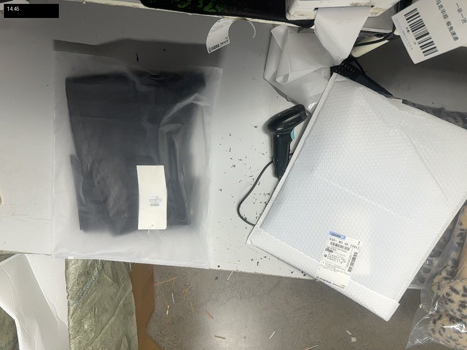
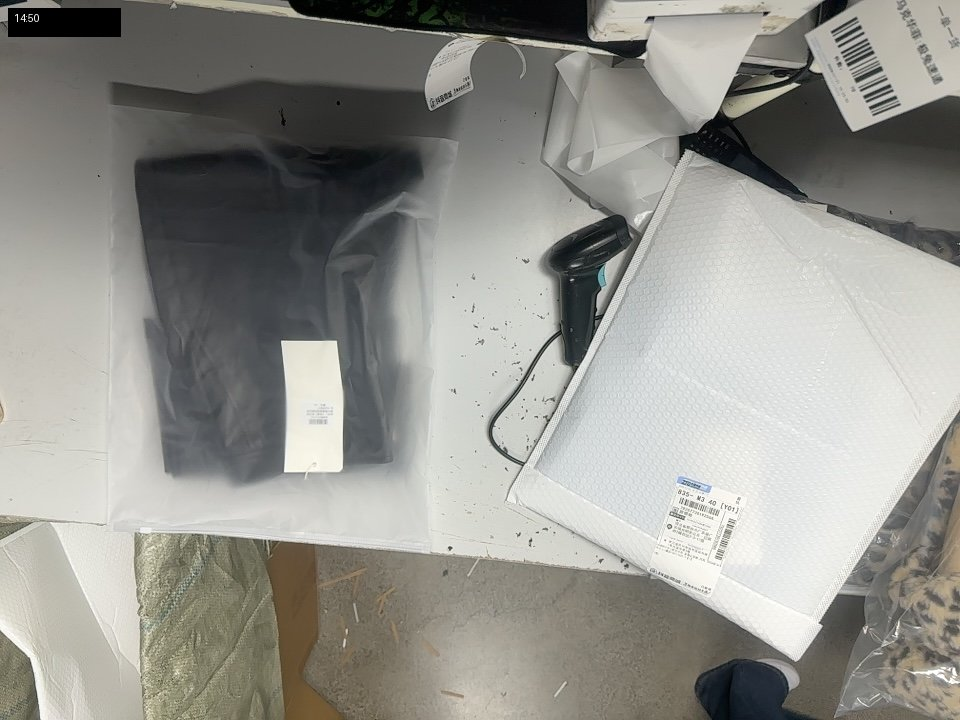
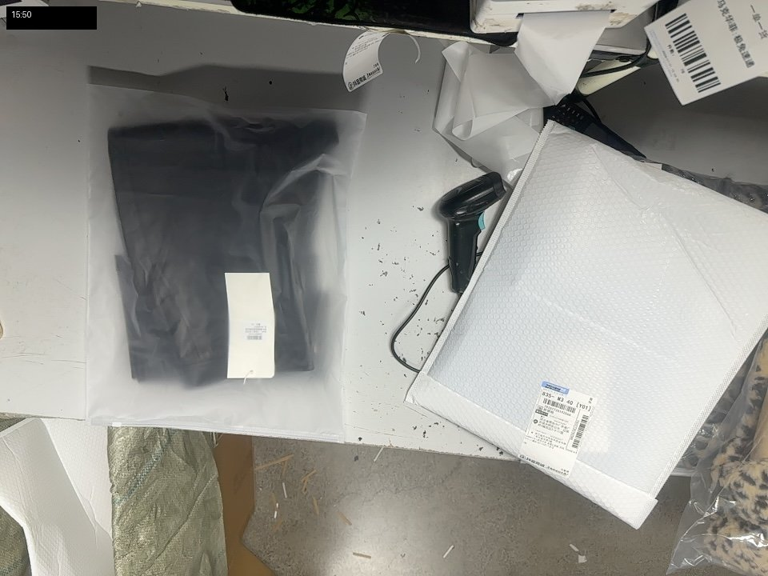
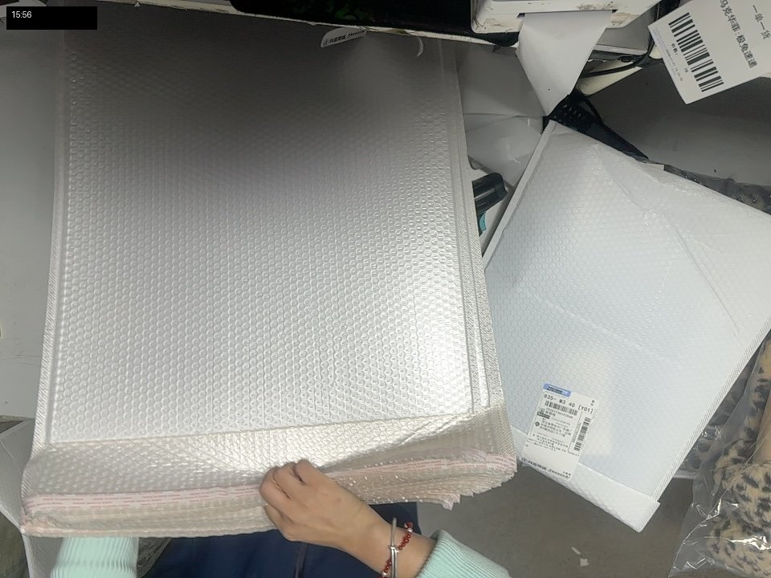
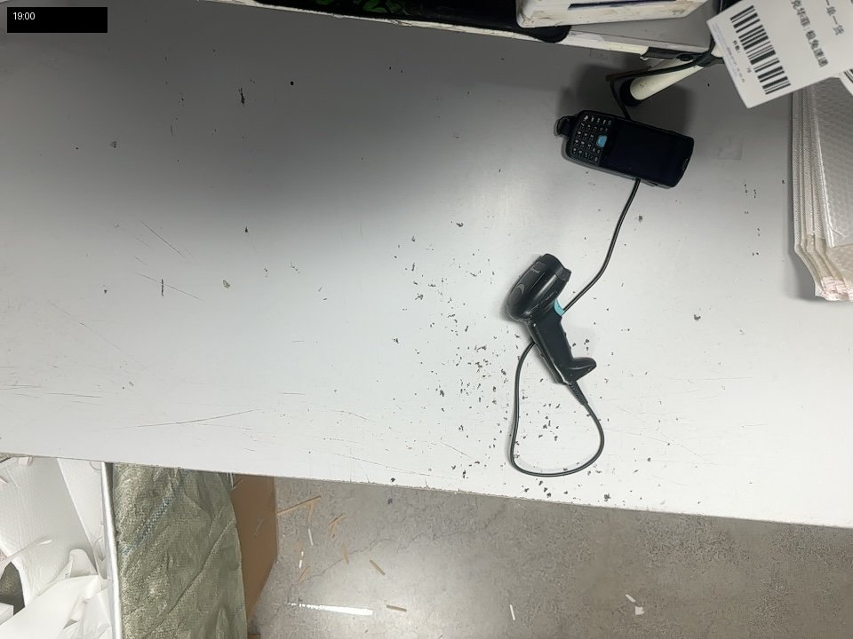
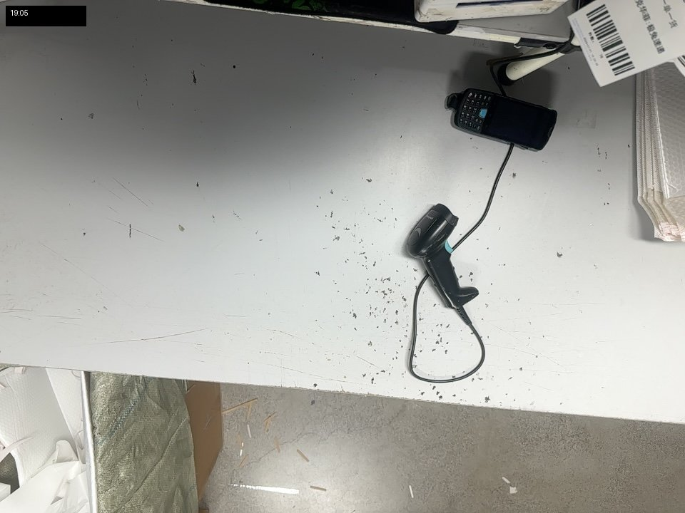
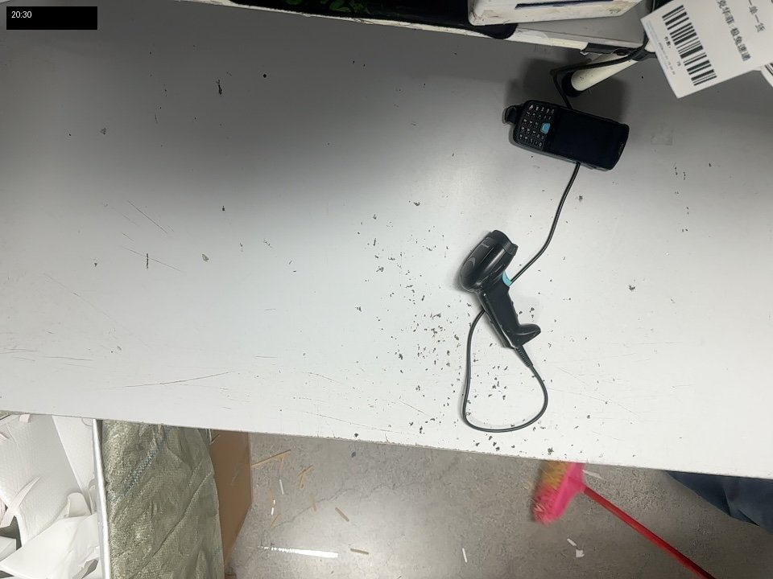
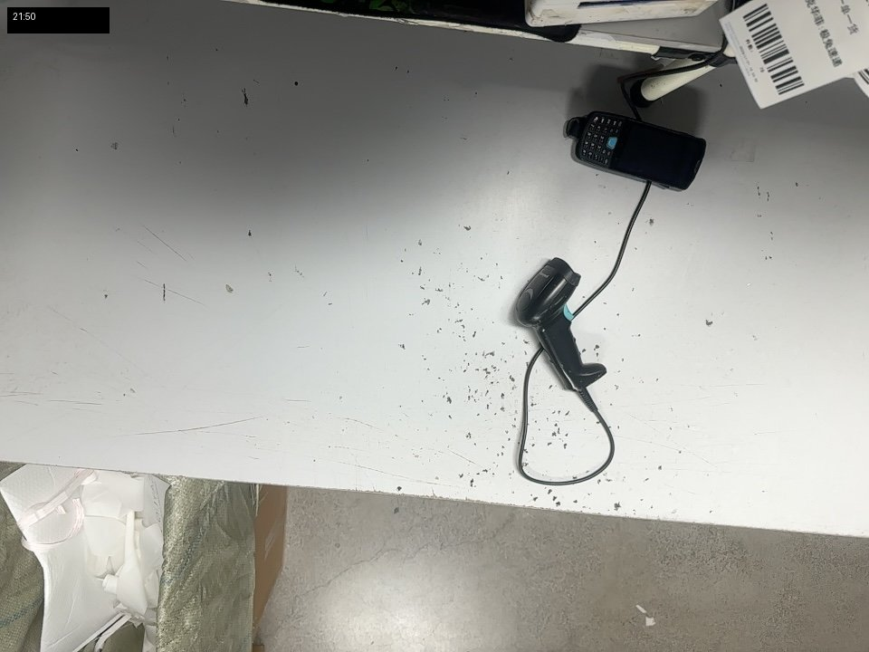
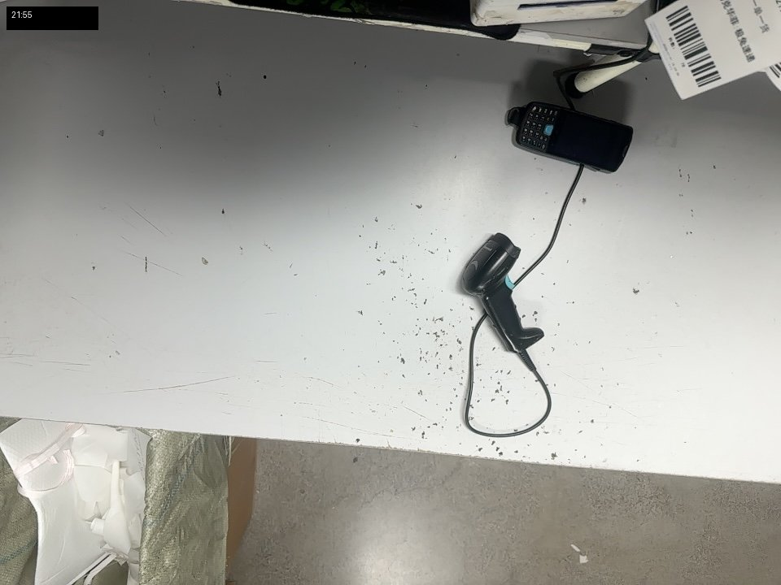
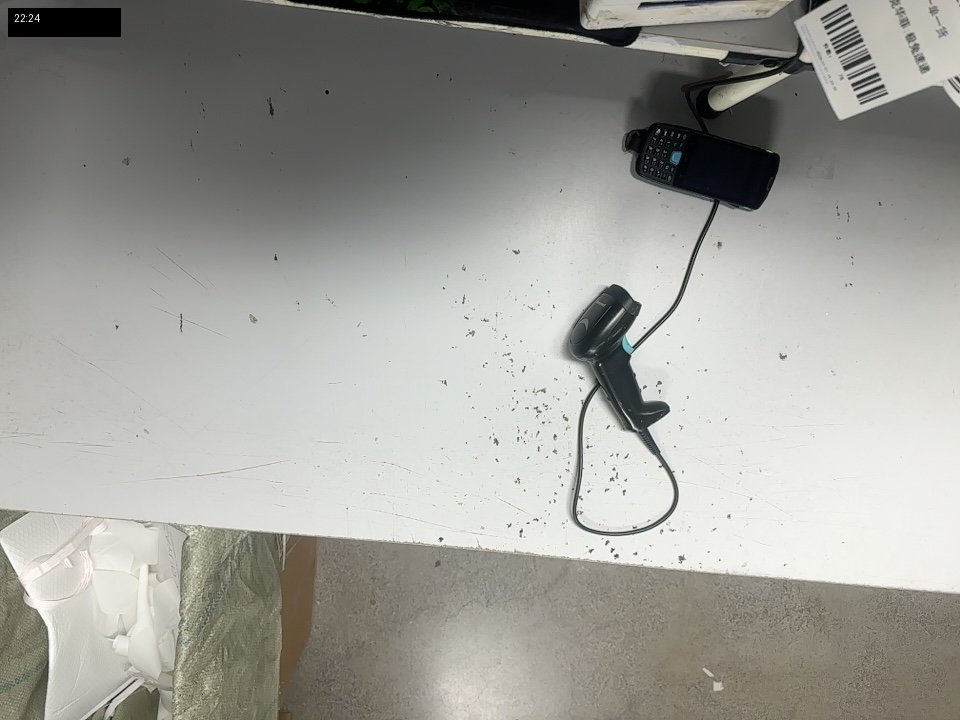

# 人手检测后的空档

工位相机主要拍到的是手。这一轮用 MediaPipe Hands，不用人体框。连续 15 秒工位上看不到手，并且帧差低于 0.02，才标 `idle_no_person`。两端各留 5 秒。SigLIP 的 0.02 门槛没有改，模型也没有换成更大的。

- `episode_20261121T111754Z_068864d3-4a08-4f8e-8719-55ea200d8b7e`
- 每 5 秒一帧，共 270 帧，其中 163 帧工位上有手
- 检测器 MediaPipe Hands 0.10.21，置信度 0.5。工位多边形是整幅画面

## 人工指出的两段

13:53–14:15 没有标成空档。14:45–15:15 标上了，并且空档一直延续到 15:56，手回到画面才结束。

13:55 手上还在桌面上。14:00 手已经离开，但和前一帧的差是 0.11。14:05 桌子是空的，帧差仍有 0.034，高于 0.02。真正低于 0.02 的只有 14:10 和 14:15，一共 10 秒，不到 15 秒。14:20 人已经回到桌前放气泡袋，这一帧 MediaPipe 没检出手，帧差 0.051，所以也没有被记进空档。

| 播放时间 | 有手 | 帧差 |
| --- | ---: | ---: |
| 13:50 | 有 | 0.155 |
| 13:55 | 有 | 0.117 |
| 14:00 | 无 | 0.112 |
| 14:05 | 无 | 0.034 |
| 14:10 | 无 | 0.019 |
| 14:15 | 无 | 0.019 |
| 14:20 | 无（手在画面里，没检出） | 0.051 |
| 14:25 | 有 | 0.173 |

14:45 起手不在画面里，帧差掉到 0.01 附近，直到 15:56 手拿着气泡袋回到画面。15:30 桌子仍是空的。播放器上看到的 15:15 还在这段空档里面。

## 标出的空档

| 原始起 | 原始止 | 削边后起 | 削边后止 | 帧差 |
| --- | --- | --- | --- | ---: |
| 14:45 | 15:56 | 14:50 | 15:51 | 0.011 |
| 19:00 | 20:35 | 19:05 | 20:30 | 0.010 |
| 21:50 | 22:29 | 21:55 | 22:24 | 0.010 |

19:05 和 21:55 都是空桌，扫描枪还在桌上。20:35 人从下沿回到画面，空档在这之前结束。22:29 片子结束，人还没回来。

base 和 so400m 原来整段都是 `uncertain`。融合以后，上面三段是 `idle_no_person`，原因 `no_hand_low_motion`。手还在、或帧差高于 0.02 的部分仍是 `uncertain`，没有因为人手检测去改 SigLIP 的分。

12:00 下沿有一只握着的手，MediaPipe 没检出。那几秒帧差是 0.10–0.17，没有被标成空档。

## 切换附近的帧

- 
- 
- 
- 
- 
- 
- 
- 
- 
- 
- 
- 
